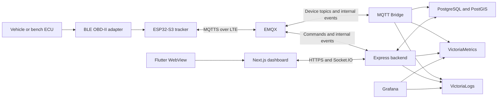

# IVTS system architecture

IVTS collects location, vehicle measurements and device events from ESP32-S3 trackers so fleet operators can monitor vehicles, review their history and manage devices. MQTT carries device traffic. The Express backend provides the operator API and Socket.IO updates. The Flutter app hosts the same Next.js dashboard in a WebView and adds native capabilities.

## Runtime boundaries

| Boundary | Ownership |
| --- | --- |
| Device | [Primary ESP-IDF firmware](../iot-vehicle-tracking-system-firmware/esp-idf/) owns sensing, tracking state, local buffering, MQTT publishing and OTA. The [legacy firmware](../iot-vehicle-tracking-system-firmware/esp-idf-legacy/) remains a separate build. |
| Bench ECU | [Arduino Uno and MCP2515](../iot-vehicle-tracking-system-ecu-simulator/ecu-simulator/README.md) emulate an OBD-II ECU over CAN. A BLE OBD adapter connects the bench to the tracker. Cloud simulator traffic enters through EMQX. |
| Device ingress | [MQTT Bridge](../iot-vehicle-tracking-system-cloud/Tracking_MqttBridge/src/index.ts) routes device topics, validates payloads, resolves session identity, updates device state and publishes internal events. |
| Operator API | [Express backend](../iot-vehicle-tracking-system-cloud/Tracking_Backend/src/index.ts) owns authenticated reads and actions, command dispatch and realtime delivery. PostgreSQL holds device, fleet and session records. |
| Clients | [Next.js](../iot-vehicle-tracking-system-cloud/Tracking_Frontend/src/app/) renders the login and fleet dashboard. [Flutter](../iot-vehicle-tracking-system-cloud/Tracking_Mobile/lib/features/webview/) hosts the web UI and mediates native auth, notifications and device APIs. |

## Telemetry and session lifecycle

The firmware opens and closes its local driving session based on ignition and whether tracking is enabled. It persists those boundary events in NVS and sends them on `status`. The bridge resolves `local_session_key` and `boot_id` to a PostgreSQL session and sends `assign_session` on the device command topic. The backend preserves device-reported and server-observed times so a delayed replay can be interpreted correctly. Parked heartbeat visibility is distinct from an active driving session.

The primary firmware publishes to EMQX at QoS 1. EMQX delivers `rawdata` to the bridge's QoS 0 subscription. The bridge receives `status`, `events`, `firmware` and `commands/ack` at QoS 1 and waits for the relevant handler to finish before acknowledging the broker. The device's broker acknowledgment and the bridge's acknowledgment are separate protocol exchanges. Session receipts, event message IDs and live-state watermarks protect the corresponding database writes from duplicate or stale input.

The bridge forwards eligible raw telemetry as an internal `data` event and sends measurements to the metrics pipeline. The [backend MQTT listener](../iot-vehicle-tracking-system-cloud/Tracking_Backend/src/infrastructure/realtime/mqtt-event-listener.ts) stores the forwarded raw telemetry in PostgreSQL `event_logs`, which serves telemetry history and session samples. The dashboard uses separate live events for current status and position.

The bridge checks the vehicle's active allowed zone when it accepts a live position. This path uses the zone's configured geometry and alert mode.

## Commands and OTA

A permitted operator action records a command in PostgreSQL and the backend publishes it through EMQX. Firmware reports the application result on `commands/ack`. The bridge forwards that result as an internal event and the backend reconciles the command record before emitting `command:ack`. OTA also reports its own job progress over `firmware` because receiving a command and successfully installing an image are distinct outcomes.

## Client access and realtime

The root route redirects to `/login`. Next.js Proxy checks for the session cookie on protected dashboard routes. Backend authorization also checks the authenticated user and applicable asset grants. Socket.IO delivers events to scoped device, user or system-admin rooms. The dashboard fetches API snapshots for initial state and recovery after reconnection. The mobile bridge checks the configured origin, the calling frame and the current top-level page before granting native access.

## Deployment and source references

The service Compose manifests share the external `tracking-network`. In the documented `mqtt.thingdock.dev` topology, Nginx Proxy Manager terminates WSS and forwards it to EMQX on port 8083. Native MQTTS passes through port 8883 to EMQX, which terminates TLS. Use the Compose profiles and environment-specific overrides to determine host bindings.

- [System design reference set](../resources/references/template/system-design/01-overview.md)
- [Cloud architecture walkthrough](../iot-vehicle-tracking-system-cloud/documents/programming-knowledge/cloud-programming-guide/01-system-architecture.md)
- [Firmware variants and bench validation](../iot-vehicle-tracking-system-firmware/README.md)
- [Runtime configuration and local setup](../README.md)
