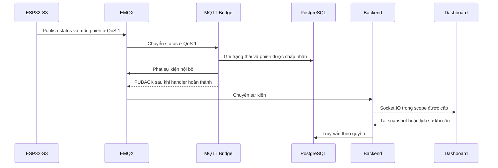

# 01 - System Architecture

Cloud của IVTS nhận bản tin qua EMQX. MQTT Bridge cập nhật trạng thái và phiên, còn backend ghi lịch sử từ sự kiện telemetry và cấp dữ liệu đã phân quyền qua Express và Socket.IO. Flutter chạy dashboard trong WebView. [Kiến trúc IVTS](../../../../docs/system-architecture.md) nối các service với firmware và bench ECU.

## Bản đồ service

| Service | Trách nhiệm |
| --- | --- |
| Tracking_EMQX | Broker và ranh giới kết nối MQTT. |
| Tracking_MqttBridge | Kiểm tra bản tin, lưu trạng thái và phiên, phát sự kiện nội bộ. |
| Tracking_Backend | Lưu mẫu lịch sử, API theo phạm vi tài sản, lệnh MQTT và Socket.IO. |
| Tracking_Frontend | Dashboard Next.js trên HTTP 4001. |
| Tracking_Mobile | Flutter WebView và dịch vụ native. |
| Tracking_PostgreSQL | PostgreSQL và PostGIS cho dữ liệu nghiệp vụ, trạng thái và lịch sử. |
| Tracking_VictoriaMetrics, Tracking_VictoriaLogs, Tracking_Grafana | Chuỗi metrics, log và dashboard giám sát. |
| Tracking_NPM | Proxy web và điểm vào MQTT bên ngoài theo cấu hình môi trường. |

## Từ tracker đến dashboard

Firmware chính publish `rawdata` ở QoS 1 trên chặng lên broker. Bridge đăng ký `rawdata` ở QoS 0 để nhận mẫu telemetry. Các topic trạng thái, sự kiện, firmware và kết quả lệnh được Bridge nhận ở QoS 1. Bridge có thể gửi `assign_session` để tracker biết định danh canonical trong PostgreSQL.

Sau một lần reconnect, dashboard tải lại snapshot từ API và Socket.IO đăng ký lại các room cần dùng. Snapshot hiện tại và lịch sử telemetry có đường đọc riêng. Lịch sử thiết bị và phiên lấy dữ liệu đã ghi nhận trong PostgreSQL.

## Từ dashboard đến tracker

Người dùng gửi lệnh qua `POST /api/v1/devices/:id/command`. Backend kiểm tra quyền, ghi command record rồi dispatch MQTT. Tracker nhận `v1/{device_id}/commands` và trả kết quả ở `commands/ack`. Bridge chuyển kết quả thành sự kiện nội bộ để backend cập nhật lệnh và báo qua Socket.IO. Tiến độ OTA đến từ topic `firmware`.

## Mạng và triển khai

Các service Compose dùng `tracking-network`. Trong topology Nginx Proxy Manager, WSS kết thúc TLS tại proxy và đi tới EMQX qua 8083. MQTTS đi qua stream 8883 và TLS kết thúc tại EMQX. Đọc [bản triển khai](../../../../resources/references/template/system-design/09-deployment.md) để xem listener, Compose và UAT.

Tiếp theo đọc [02 - MQTT Bridge Service](02-mqtt-bridge-service.md). Đối chiếu QoS và ACK với [thiết kế realtime](../../../../resources/references/template/system-design/06-realtime-design.md).
