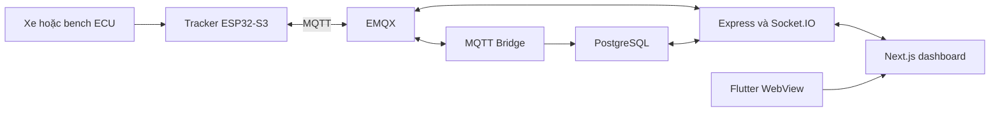

# 01. Tổng quan hệ thống IVTS

IVTS nối thiết bị theo dõi trên xe với dashboard điều hành đội xe. Tracker thu vị trí, trạng thái nguồn và dữ liệu OBD-II khi có adapter tương thích. Cloud lưu lịch sử, phát thay đổi theo thời gian thực và chuyển lệnh hợp lệ xuống thiết bị.

[Kiến trúc IVTS trong repository](../../../../docs/system-architecture.md) mô tả các ranh giới chính. Bộ tài liệu này giải thích từng ranh giới và dẫn đến mã nguồn thực hiện.

| Khu vực | Thành phần và ranh giới |
| --- | --- |
| Trên xe | ESP32-S3 chạy FreeRTOS. SIM7600 đảm nhiệm LTE, GNSS và kết nối MQTT. Adapter BLE OBD-II cung cấp dữ liệu ECU khi có kết nối. |
| Cloud | EMQX chuyển bản tin. MQTT Bridge xử lý ingest. Backend cung cấp API, quyền truy cập, lệnh thiết bị và Socket.IO. |
| Dữ liệu | PostgreSQL lưu trạng thái, phiên, lịch sử và dữ liệu nghiệp vụ. VictoriaMetrics và VictoriaLogs phục vụ luồng metrics và logs. |
| Người vận hành | Next.js hiển thị dashboard. Flutter hiển thị dashboard trong WebView và kết nối với các chức năng native. |
| Kiểm thử bench | Arduino Uno và MCP2515 mô phỏng một ECU trên CAN. Một adapter OBD BLE có thể nối bench với tracker để kiểm tra đường truyền thực tế. |

## Các phần thiết kế

| Tài liệu | Phạm vi |
| --- | --- |
| [02. Yêu cầu](02-requirements.md) | Hành vi nghiệp vụ và điều kiện kiểm chứng |
| [03. Kiến trúc](03-architecture.md) | Quyền sở hữu logic, trạng thái và giao tiếp giữa các lớp |
| [04. Dữ liệu](04-database-design.md) | Phiên xe, lịch sử telemetry, giao dịch và migration |
| [05. API](05-api-design.md) | Route HTTP, envelope, lệnh và export |
| [06. Realtime](06-realtime-design.md) | MQTT, Socket.IO và khôi phục sau reconnect |
| [07. Frontend](07-frontend-design.md) | Dashboard, bản đồ, cache và Flutter WebView |
| [08. Bảo mật](08-security.md) | Danh tính người dùng, quyền tài sản, ACL thiết bị và origin WebView |
| [09. Triển khai](09-deployment.md) | Compose, cổng dịch vụ, TLS và phát hành UAT |
| [10. Giám sát](10-monitoring.md) | Readiness, metrics, logs và cách lần theo bản tin |
