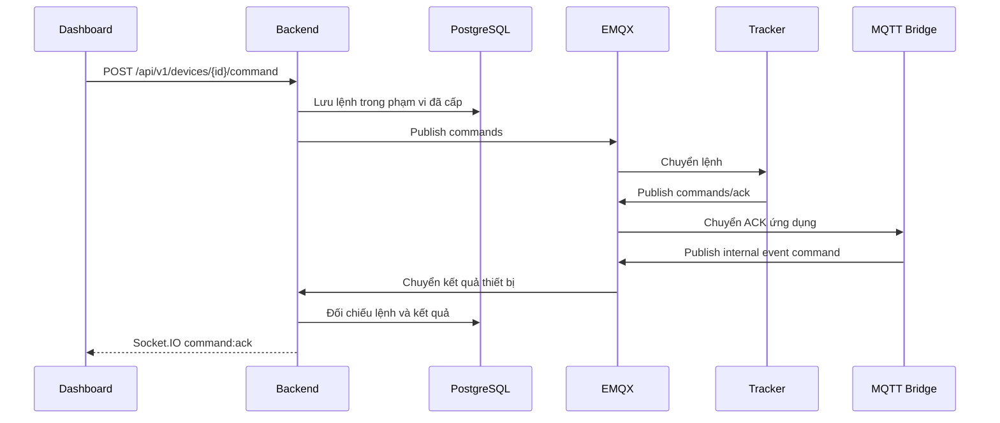

# 06. Thiết kế realtime IVTS

## Hợp đồng MQTT

Topic thiết bị nằm dưới `v1/{device_id}/`. Firmware ESP-IDF chính dùng QoS 1 khi publish lên EMQX. Bảng ghi riêng QoS bridge yêu cầu từ broker trên đường nhận.

| Topic | Hướng | QoS ở bridge | Dữ liệu |
| --- | --- | --- | --- |
| `rawdata` | Tracker → EMQX → Bridge | 0 | Telemetry, tọa độ và dữ liệu replay |
| `status` | Tracker → EMQX → Bridge | 1 | Heartbeat, trạng thái và mốc phiên |
| `events` | Tracker → EMQX → Bridge | 1 | Sự kiện thiết bị |
| `firmware` | Tracker → EMQX → Bridge | 1 | Trạng thái job OTA |
| `commands/ack` | Tracker → EMQX → Bridge | 1 | Kết quả xử lý lệnh |
| `commands` | Backend hoặc Bridge → EMQX → Tracker | Bridge publish `assign_session` ở QoS 1 | Lệnh điều hành hoặc gán định danh phiên |

Với bản tin QoS 1 đi vào Bridge, MQTT.js chờ handler thành công trước khi gửi PUBACK cho EMQX. Nếu handler gặp lỗi xử lý, Bridge báo lỗi thay vì xác nhận thành công. PUBACK mà tracker nhận từ EMQX thuộc chặng publish ban đầu. Cần tính riêng khả năng mất bản tin ở subscription QoS 0.

## Đường trả kết quả lệnh

`assign_session` dùng chung topic `commands` để trả định danh canonical cho khóa cục bộ và boot ID. Đây là thông điệp nội bộ giữa Bridge và firmware. Kết quả của một tác vụ OTA tiếp tục đi qua topic `firmware`.

## Socket.IO và khôi phục

Backend nhận `internal/events/device/*` từ EMQX và ánh xạ sang sự kiện có tên phân cách bằng dấu hai chấm, ví dụ `device:status`, `device:position` hoặc `device:session_end`. Các namespace dashboard, thiết bị, thông báo, export và firmware kiểm tra phiên backend. Khi client yêu cầu vào `device:{deviceId}`, server kiểm tra grant. Các sự kiện thuộc người dùng hoặc vận hành được chuyển đến room người dùng hoặc system-admin tương ứng.

Client tải snapshot qua HTTP lúc mở trang và làm mới cache khi reconnect. `SocketProvider` giữ số lượng bên dùng mỗi room thiết bị để một màn hình rời đi không làm gián đoạn màn hình còn dùng cùng dữ liệu.

- [Firmware publish](../../../../iot-vehicle-tracking-system-firmware/esp-idf/components/modem/src/modem_mqtt.c)
- [QoS của Bridge](../../../../iot-vehicle-tracking-system-cloud/Tracking_MqttBridge/src/mqtt/subscriptions.ts)
- [Thứ tự xử lý và PUBACK](../../../../iot-vehicle-tracking-system-cloud/Tracking_MqttBridge/src/mqtt/ingress.ts)
- [Socket.IO gateway](../../../../iot-vehicle-tracking-system-cloud/Tracking_Backend/src/infrastructure/realtime/socket-server.util.ts)
